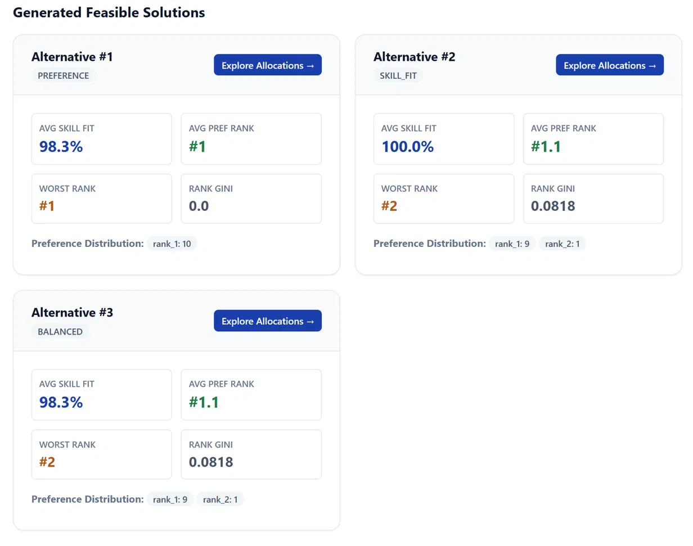
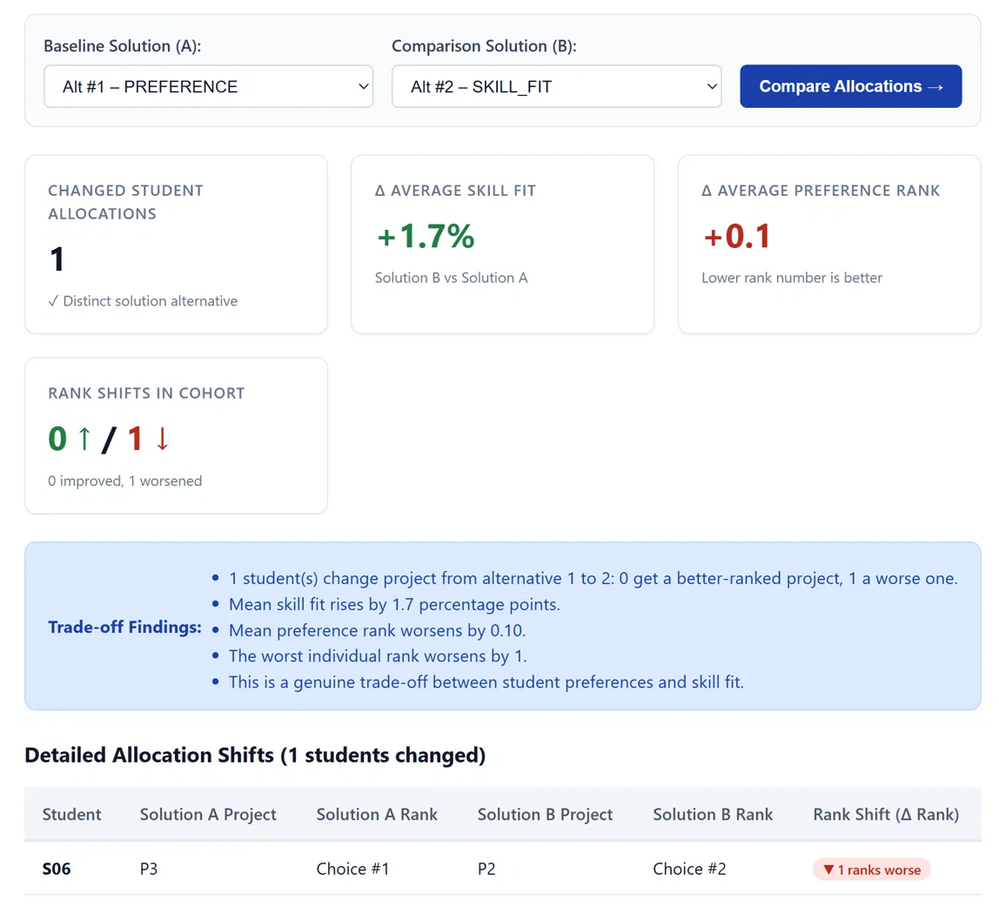
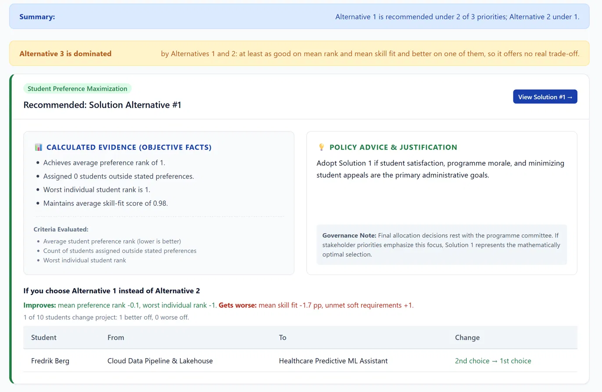
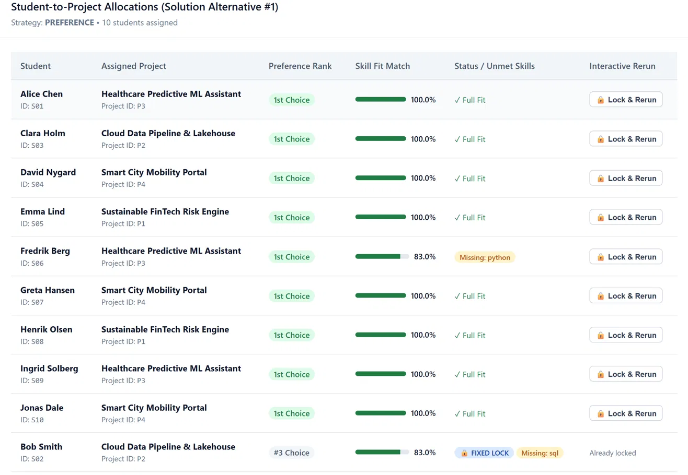
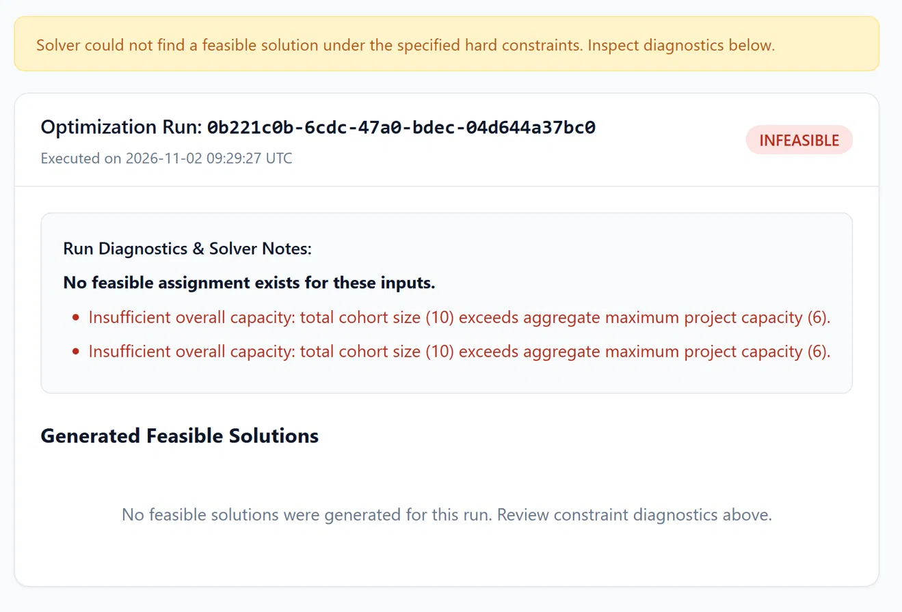

# TECH5 Assignment Support System: Reproducible Demonstration

## 1. Overview

This walkthrough runs the four benchmark scenarios built into the app and shows
the numbers you should see. All numbers below come from the real
`AssignmentEngine` (ILP, Pyomo/HiGHS) and are reproducible: the scenarios are
fixed data and the solver is deterministic.

### Quick start
```powershell
.\.venv\Scripts\activate
pip install -r requirements.txt
python run.py
```
Open **`http://127.0.0.1:5000`**.

Loading a scenario replaces all students, projects, skills and fixed
assignments, and removes earlier runs, since they no longer match the data.

All runs below use the Dashboard defaults: strategy **Student Preference
Maximization** and **3 Distinct Solutions**.

---

## 2. Scenario 1: Standard Trade-Off Benchmark

**Shows:** distinct alternatives, a visible trade-off, a dominated alternative,
comparison and recommendations.

**Cohort:** 10 students (`S01`–`S10`), 4 projects (`P1`–`P4`), 5 skills.

### 2.1 Run
1. **Scenarios** → **1. Standard Trade-Off Benchmark** → load.
2. **Dashboard** → **Launch Optimization Run**.
3. Message: *"Optimization run completed! Found 3 distinct alternative
   solutions."*

| Alternative | Mean rank | Worst rank | Rank distribution | Gini | Mean skill fit | Unmet soft req. | Note |
|---|---|---|---|---|---|---|---|
| 1 `PREFERENCE` | 1.00 | 1 | 10 × 1st | 0.000 | 98.3 % | 1 | |
| 2 `SKILL_FIT` | 1.10 | 2 | 9 × 1st, 1 × 2nd | 0.082 | 100.0 % | 0 | |
| 3 `BALANCED` | 1.10 | 2 | 9 × 1st, 1 × 2nd | 0.082 | 98.3 % | 1 | Dominated by 1 and 2 |

No student is assigned outside their preferences in any alternative.



### 2.2 Compare (Alternative 1 vs Alternative 2)
1. **Compare** → A: `Alt #1 – PREFERENCE`, B: `Alt #2 – SKILL_FIT` (both
   under the same run) → **Compare Allocations**.
2. Expected:
   - 1 student changes project: **S06 (Fredrik Berg)**, `P3` (1st choice) →
     `P2` (2nd choice).
   - Δ mean skill fit **+1.7 pp**, Δ mean rank **+0.10**, Δ worst rank **+1**,
     Δ Gini **+0.082**, unmet soft requirements **−1**.
   - Trade-off findings end with *"This is a genuine trade-off between student
     preferences and skill fit."*

This is the core trade-off of the demo: moving one student to their second
choice gives every project full skill coverage.



### 2.3 Recommendations
1. From the run page, click **View Recommendations**.
2. Expected:
   - Summary: *"Alternative 1 is recommended under 2 of 3 priorities;
     Alternative 2 under 1."*
   - Warning: *"Alternative 3 is dominated by Alternatives 1 and 2"*, so it is
     never compared against.
   - Student Preference and Balanced priorities → **Alternative 1**.
     Project Skill Quality → **Alternative 2**.
   - Under each card, *"If you choose Alternative X instead of Alternative Y"*
     lists what improves, what gets worse, and the moved student (Fredrik Berg,
     "1st choice → 2nd choice" or the reverse).



---

## 3. Scenario 2: Fixed Assignment and Rerun

**Shows:** an administrative lock is kept in every alternative, and its cost is
visible.

**Cohort:** the standard cohort with **S02 (Bob Smith)** locked to **P2**.
P1 is Bob's first choice; P2 is his third.

### 3.1 Run
1. **Scenarios** → **2. Fixed Assignment & Rerun Scenario** → load.
2. **Fixed Locks**: `S02 → P2` is listed with its reason.
3. **Dashboard** → **Launch Optimization Run** (3 alternatives).

| Alternative | Mean rank | Worst rank | Rank distribution | Gini | Mean skill fit | Unmet soft req. | Note |
|---|---|---|---|---|---|---|---|
| 1 `PREFERENCE` | 1.20 | 3 | 9 × 1st, 1 × 3rd | 0.150 | 96.7 % | 2 | |
| 2 `SKILL_FIT` | 1.30 | 3 | 8 × 1st, 1 × 2nd, 1 × 3rd | 0.192 | 98.3 % | 1 | |
| 3 `BALANCED` | 1.30 | 3 | 8 × 1st, 1 × 2nd, 1 × 3rd | 0.192 | 96.7 % | 2 | Dominated by 1 and 2 |

- S02 is on P2 with a **fixed lock** badge in all three alternatives.
- Compared with Scenario 1, mean rank rises from 1.00 to 1.20 and the worst
  rank is 3. Both are caused entirely by the lock.


- Alternative 1 vs 2 again moves only S06 (P3 → P2): skill fit +1.7 pp, mean
  rank +0.10.

### 3.2 Interactive lock and rerun
1. Open a solution (**Explore Allocations**).
2. In the allocation table, press **Lock & Rerun** on any student and confirm.
3. A new run is created. The new lock and S02 → P2 hold in every alternative,
   and the old run is kept unchanged for comparison.

---

## 4. Scenario 3: Capacity Deficit (Infeasible)

**Shows:** infeasibility is detected before solving and explained.

**Cohort:** 10 students, total project capacity 6.

1. **Scenarios** → **3. Capacity Deficit** → load.
2. The Dashboard capacity card shows a deficit.
3. **Launch Optimization Run**.
4. Expected:
   - Message: *"Solver could not find a feasible solution under the specified
     hard constraints. Inspect diagnostics below."*
   - Run status **INFEASIBLE**, 0 solutions.
   - Reason: *"Insufficient overall capacity: total cohort size (10) exceeds
     aggregate maximum project capacity (6)."*



---

## 5. Scenario 4: Contradictory Fixed Assignments

**Shows:** locks that cannot all hold are rejected with a reason.

**Cohort:** P1 has max capacity 3, but 4 students (`S01`, `S02`, `S05`, `S08`)
are locked to it.

1. **Scenarios** → **4. Contradictory Constraints** → load.
2. **Launch Optimization Run**.
3. Expected:
   - Run status **INFEASIBLE**, 0 solutions.
   - Reason: *"Fixed assignments (4) for project 'P1' exceed its maximum
     capacity (3)."*

The data itself is valid; it is the combination of locks that cannot be met,
so the engine reports it as infeasible rather than invalid input.

---

## 6. Running the engine without the web app

The engine can be called directly through the contract:

```python
from app import create_app
from app.contract import contract
from app.engine import solvers
from app.samples import demo_data

create_app()  # initialises the database
scenario = demo_data.get_standard_scenario()

engine = solvers.AssignmentEngine()
run = engine.execute_run(
    contract.RunRequest(
        students=scenario["students"],
        projects=scenario["projects"],
        skills=scenario["skills"],
        strategy_key="PREFERENCE",
        max_alternatives=3,
    )
)
print(run.status, len(run.solutions))
for sol in run.solutions:
    fairness = sol.indicators["fairness"]
    efficiency = sol.indicators["efficiency"]
    print(sol.alternative_number, sol.strategy_name,
          fairness["mean_rank"], efficiency["mean_skill_fit"])
```

Expected output: `COMPLETED 3`, then the three rows from the table in 2.1.
